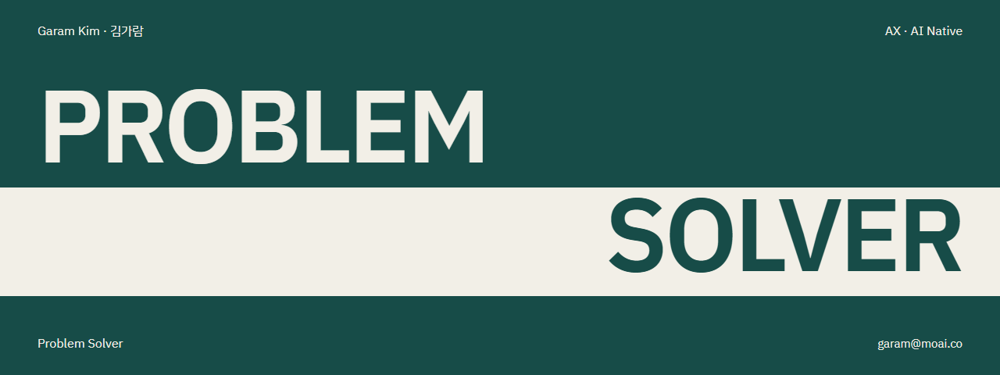

한국어 / [English](README.md)

AI가 쓰이는 제품을 만듭니다. MOAI에서 AX Engineer Intern으로 일하고 있습니다.

[사이트](https://kgr0831.github.io/) · [포트폴리오](portfolio/Garam_Kim_Portfolio.pdf) · [CV](https://kgr0831.github.io/Garam_Kim_CV.pdf) · [garam@moai.co](mailto:garam@moai.co)

| 주요 작업 | 담당 |
| --- | --- |
| **MOAI** | 관리자 검색·필터·페이지네이션, 집계 기준과 응답 처리 개선. 관리자 기능 PR 병합. |
| **[EUM](https://github.com/kgr0831/EUM2)** | 5인 팀에서 실시간 화이트보드 풀스택 개발. PixiJS v8·WebGPU 렌더러, 입력 보정과 전송 배칭. 당시 평균 23.7에서 58.7 FPS. 장비·객체 수 미기록. |
| **[두드리](https://github.com/kgr0831/KOSSCCHTHON_2026)** | AI 경험 정리·교류 플랫폼. 2026 KOSSCCHTHON 대상. 수상 후 생성·버전·게시를 분리하고, 화면에서 편집할 때 직접 작성한 코드를 보존하도록 개선. |

TypeScript · Next.js · Python · PixiJS · WebGPU · C · C# · Unity
