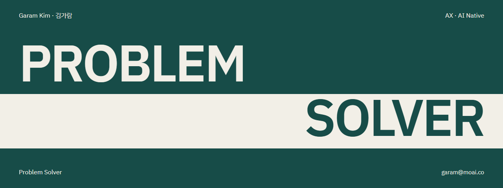

[한국어](README.ko.md) / English

I build products that put AI to use. AX Engineer Intern at MOAI.

[Website](https://kgr0831.github.io/en/) · [Portfolio](portfolio/Garam_Kim_Portfolio_EN.pdf) · [CV](https://kgr0831.github.io/Garam_Kim_CV_EN.pdf) · [garam@moai.co](mailto:garam@moai.co)

| Selected work | My contribution |
| --- | --- |
| **MOAI** | Admin search, filters, pagination and consistent aggregate counts. Admin feature PR merged. |
| **[EUM](https://github.com/kgr0831/EUM2)** | Real-time whiteboard in a five-person team. PixiJS v8 / WebGPU renderer, input smoothing and batched updates. Average 23.7 to 58.7 FPS in the original project measurement; hardware and object count were not recorded. |
| **[Dudri](https://github.com/kgr0831/KOSSCCHTHON_2026)** | AI profiles and community. 1st prize at 2026 KOSSCCHTHON. Post-award work separated generation, versions and publication while preserving hand-written code during visual editing. |
| **[On Your Mark](https://github.com/Architecture-UnityAIGameJam2026/UnityAIGameJam2026)** | In 24 hours, our four-person team built a co-op game using AI to generate the design, art, sound and code. I regenerated malformed meshes part by part, validated 64 Unity prefabs and integrated the companion AI, radio and shared HUD. [Trailer](https://kgr0831.github.io/assets/work/on-your-mark-trailer.mp4) · [Windows demo](https://github.com/Architecture-UnityAIGameJam2026/UnityAIGameJam2026/releases/tag/build-2026-11-19-level-flow) |

### Other project contributions

- **[Soongsil timetable demo](https://github.com/kgr0831/openSourceProject/tree/main/timetable-demo)** — I made 4,722 class sections from both 2026 terms selectable by term and department. The 108 sections without meeting times stay in the catalog and are excluded from recommendations.
- **[BeeRFriend careers page](https://beerfriend.co/apply.html)** — I updated the application form so applicants can provide a link or upload a file for each of their CV and portfolio. It flags missing material before submission.

TypeScript · Next.js · Python · PixiJS · WebGPU · C · C# · Unity
