

  

<h1 align="center">Garam Kim</h1>

<b>AI Native Software Engineer</b>

  
  
  
  
  
  

I find and define problems in the way people work, build, and use software. **Technology is a means to solve them.** I work with AI agents to learn unfamiliar systems, build solutions, and verify the result. Alongside the engineering, I explore what people need and why they would use a product.

## Tools I use

  <picture><source media="(prefers-color-scheme: dark)" srcset="assets/icons/unity-dark.svg"></picture>&nbsp;&nbsp;&nbsp;&nbsp;
  <picture><source media="(prefers-color-scheme: dark)" srcset="assets/icons/nextjs-dark.svg"></picture>&nbsp;&nbsp;&nbsp;&nbsp;
  <picture><source media="(prefers-color-scheme: dark)" srcset="assets/icons/orca-dark.svg"></picture>&nbsp;&nbsp;&nbsp;&nbsp;
  <picture><source media="(prefers-color-scheme: dark)" srcset="assets/icons/codex-dark.svg">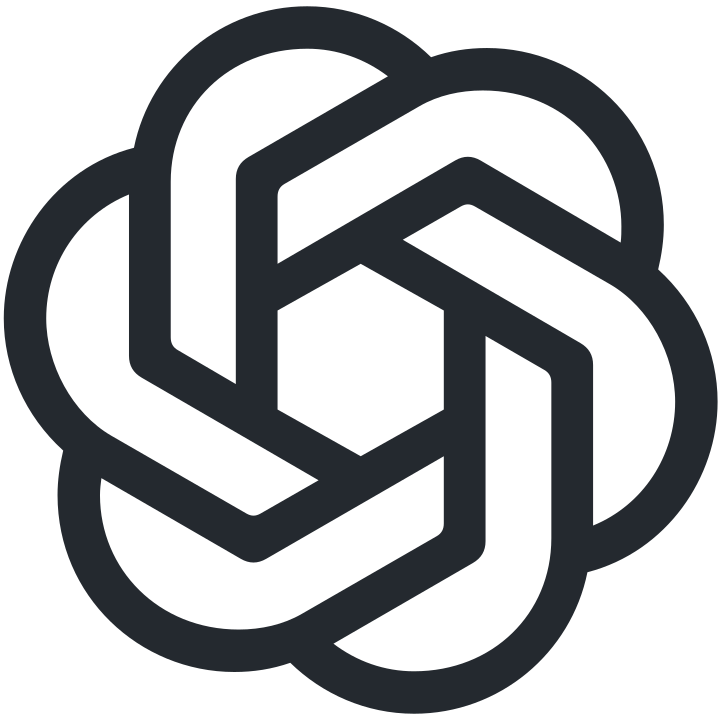</picture>&nbsp;&nbsp;&nbsp;&nbsp;
  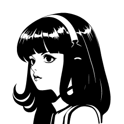

<b>Unity · Next.js</b> &nbsp; / &nbsp; Orca · Codex · Hermes

## Selected work

### EUM

**AI meeting and whiteboard workspace · Five-person team · Whiteboard developer**

<a href="https://www.youtube.com/watch?v=Pnjw9WitAXg">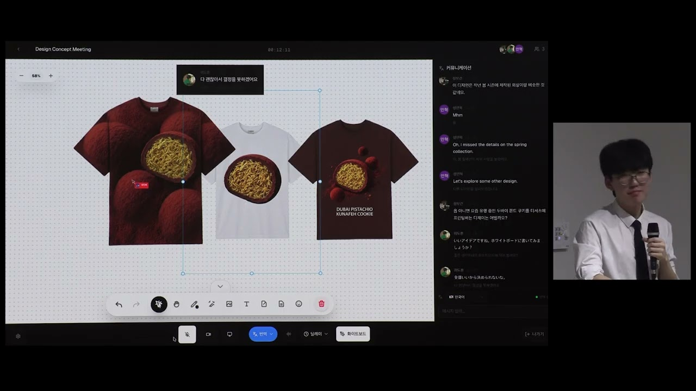</a>

Drawing became sluggish during video calls. I found the rendering bottleneck and rebuilt the whiteboard renderer with WebGPU and PixiJS v8, learning the graphics concepts with AI. **23.7 → 58.7 FPS** average in project measurements.

  
  
  

###  MOAI

**AX Engineer Intern · Sep 2026 – Present**

<a href="portfolio/Garam_Kim_Portfolio.pdf#page=6"><picture><source media="(max-width: 600px)" srcset="assets/media/moai-contributions-mobile.svg">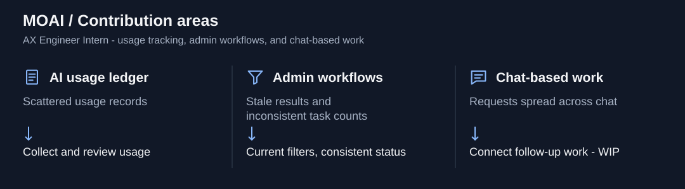</picture></a>

I contributed to usage tracking and admin workflows, fixed outdated responses overwriting current search results, and made task counts consistent with their status. Chat-based follow-up work is in development.

### Remnents of Light / ROLAI

**Solo-developed Unity action game · Released demo · Game development automation**

  <a href="https://www.youtube.com/watch?v=WHP7L8P5Be8">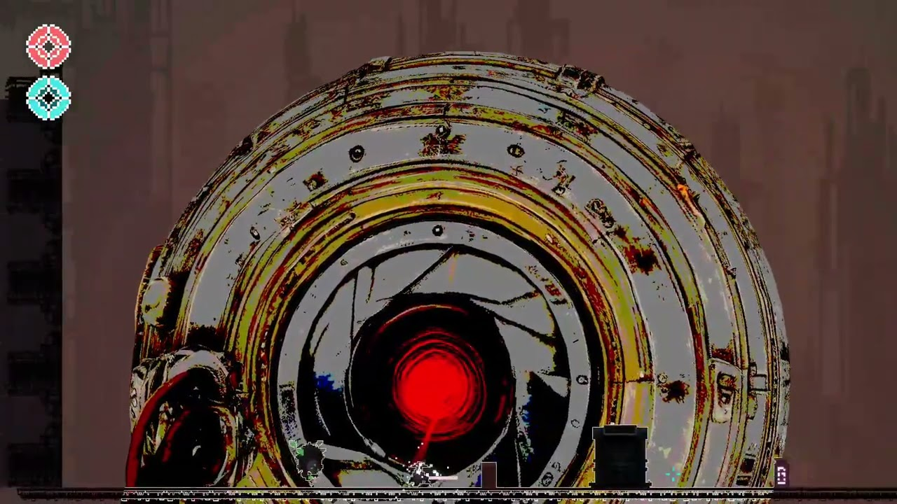</a>
  <a href="portfolio/Garam_Kim_Portfolio.pdf#page=34">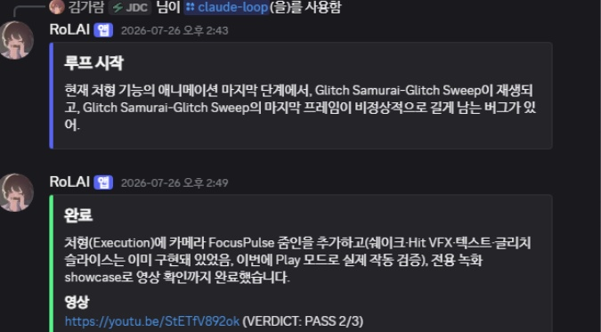</a>

I built and released the game and shaped ROLAI around its development bottlenecks: Discord requests connected to AI-driven Unity work, test logs, and gameplay recordings. Repeatable test conditions help distinguish code defects from setup failures.

  
  
  

### 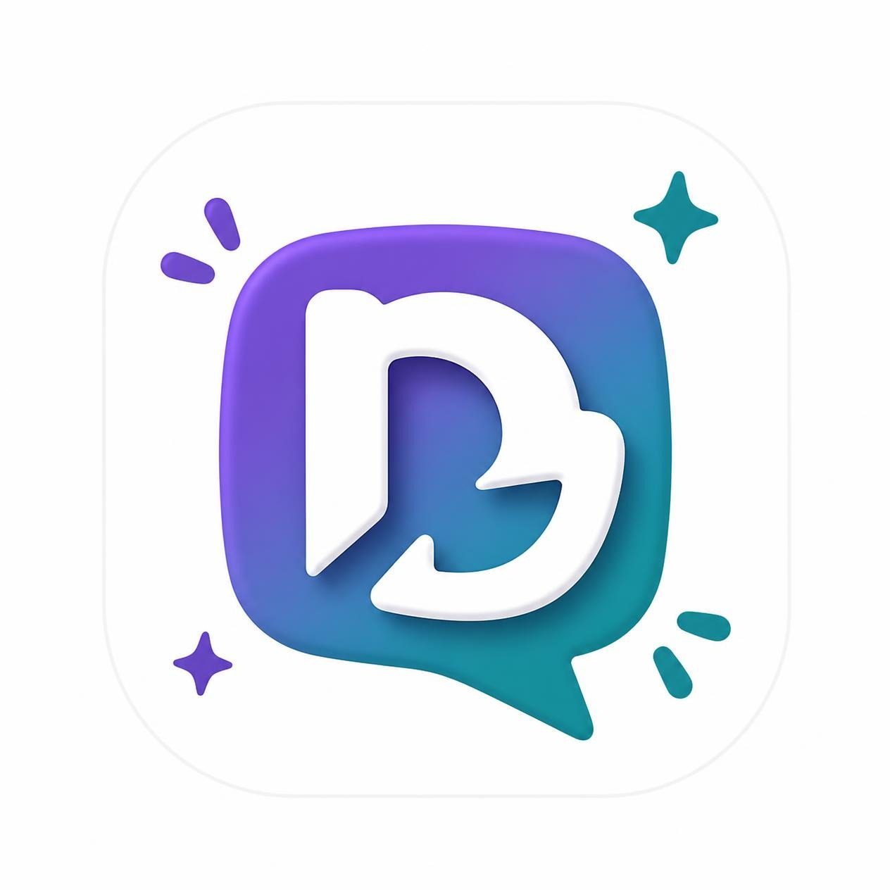 Dudri · 두드리

**Connecting students' experiences with applications, people, and projects**

<a href="https://www.youtube.com/watch?v=vvsyQIOtiUQ">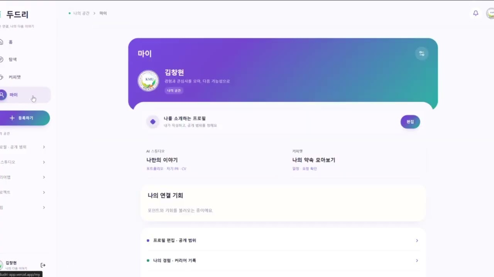</a>

An AI-assisted **specification → implementation → verification** workflow helped turn a short hackathon into a working service. **Grand Prize · 1st place, 2026 KOSSCCHTHON**, jointly held by Kookmin, Soongsil, and Soonchunhyang Universities.

  
  
  

##  Virtual Friend

  <a href="portfolio/Garam_Kim_Portfolio.pdf#page=37">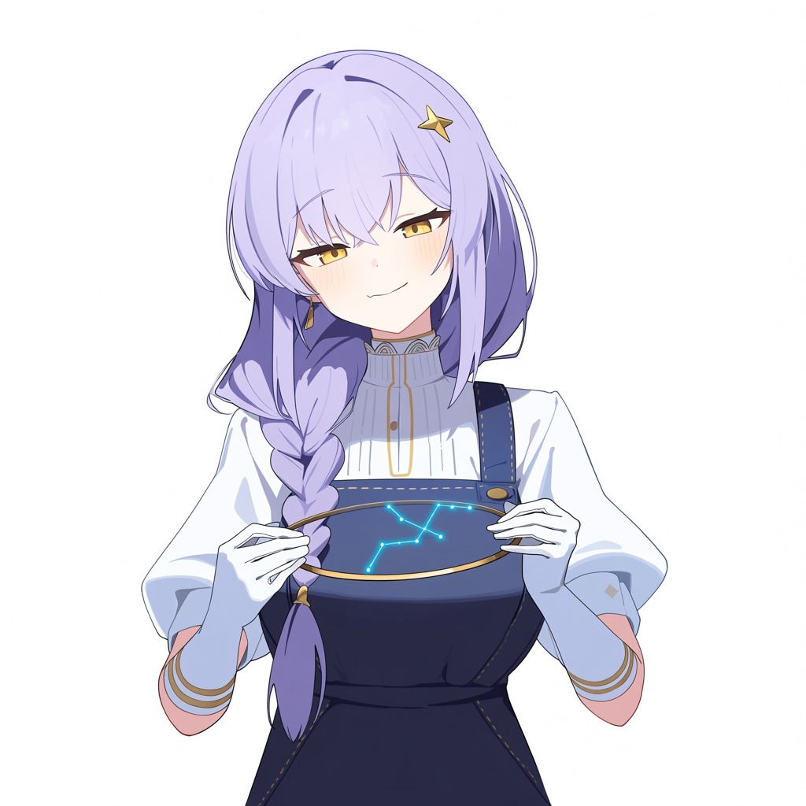</a>
  <a href="portfolio/Garam_Kim_Portfolio.pdf#page=37">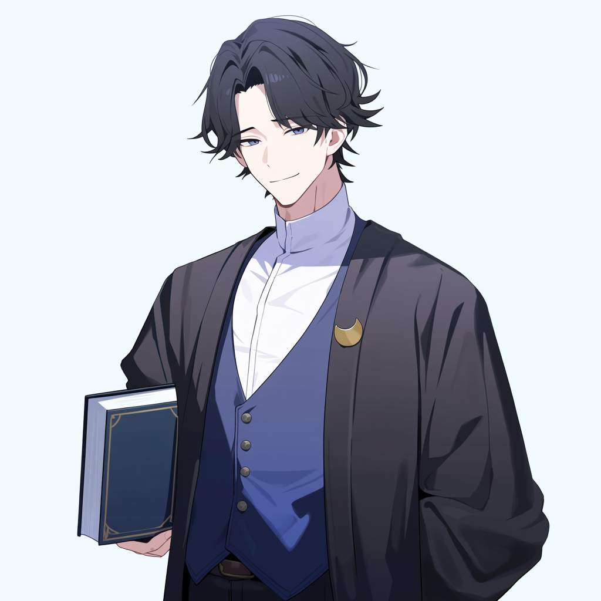</a>
  <a href="portfolio/Garam_Kim_Portfolio.pdf#page=37">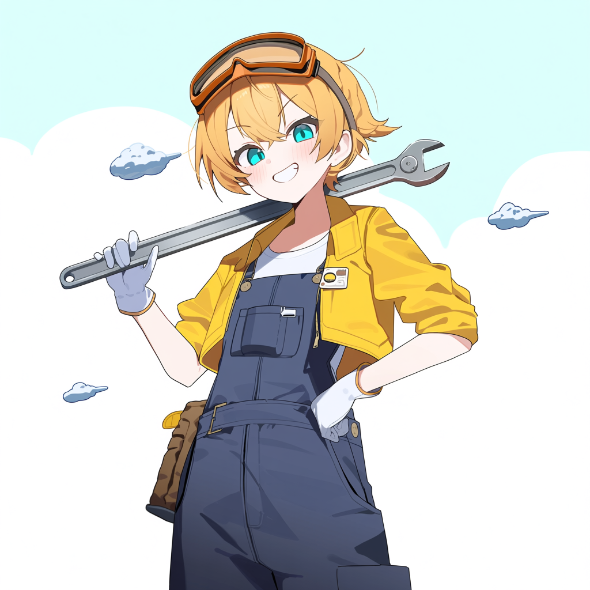</a>

Character illustrations from the prototype. I found that premature turn detection interrupted speech, while saving unheard replies made later conversations inconsistent. The local app now supports **real-time voice calls, interruptions, and shared call/chat memory**: only confirmed speech and played replies enter the record. Per-account storage and character image generation are also prototyped.

One real-API trial with synthetic microphone input took **3.48 seconds to first audio**; the 0.5-second target remains unmet. Human microphone use and larger samples are untested. Lower latency, LoRA-based visual consistency, and the business model remain work in progress.

## More automation work

<table>
  <tr>
    <td width="50%" valign="top">
      <a href="https://github.com/kgr0831/PaperBridge">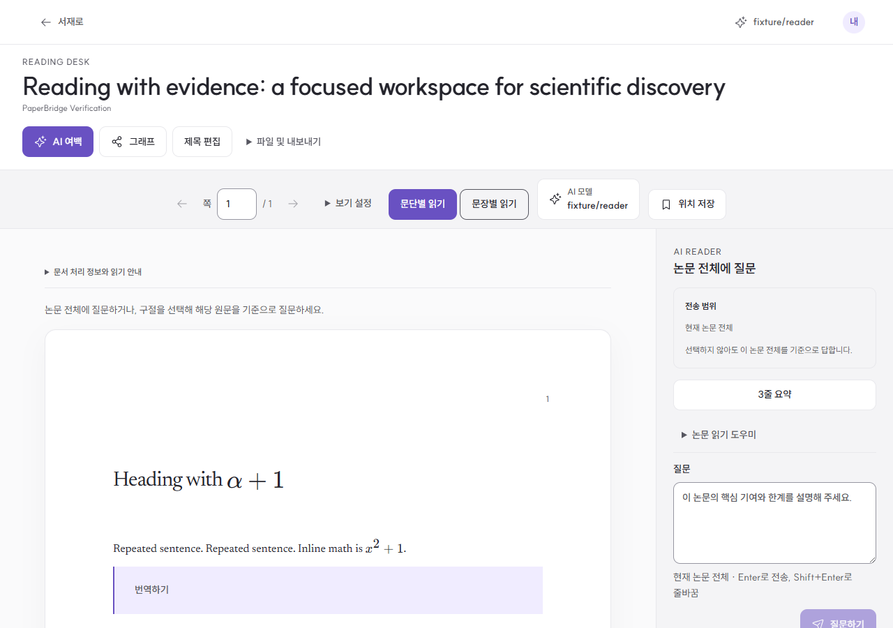</a> 
       <b>PaperBridge</b> 
      Paper reading, questions, and evidence in one workspace. Sample-document view. 
      
    </td>
    <td width="50%" valign="top">
      <a href="https://gammaru.dev/">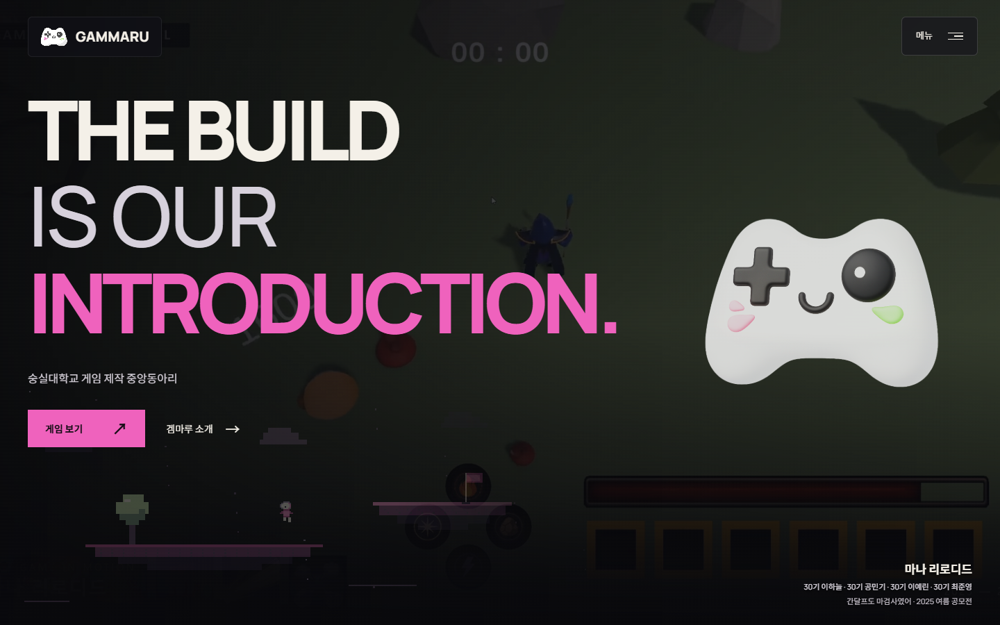</a> 
      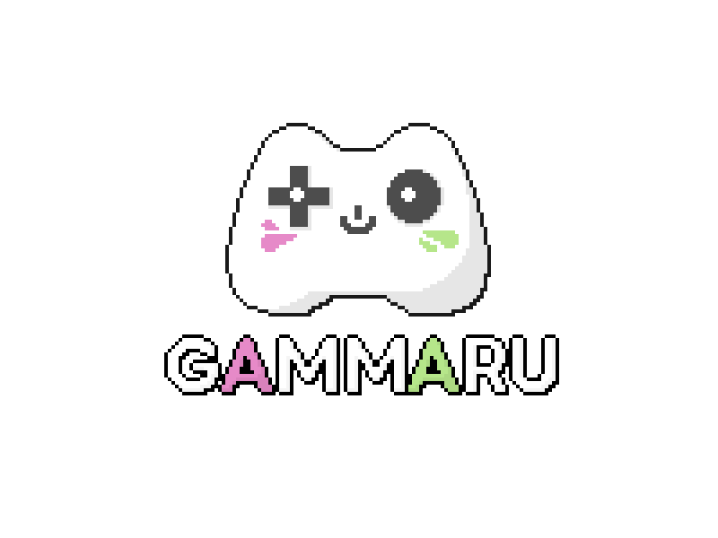 <b>Gammaru</b> 
      Public club and game pages on GitHub Pages; member reports, login, and notifications on AWS. Kept member data out of the public build while preserving the daily briefing workflow. 
      
      
    </td>
  </tr>
</table>

[**Abstraction Bot**](https://github.com/kgr0831/Abstraction-Bot) turns Discord discussions into summaries and records. My unattended screen-golf CMS work connects operations with ledger-based settlement.

## 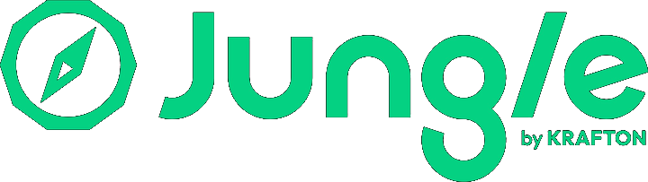 PintOS

**Operating-system fundamentals · Thread scheduling, user programs, and virtual memory**

<a href="portfolio/Garam_Kim_Portfolio.pdf#page=19"><picture><source media="(max-width: 600px)" srcset="assets/media/pintos-design-mobile.svg">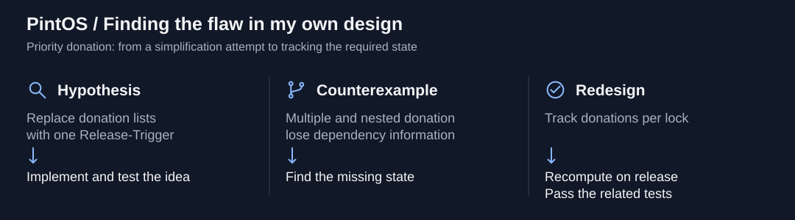</picture></a>

My Release-Trigger simplification failed under multiple and nested donations. I traced the missing dependencies and lock-release timing, rebuilt the design around per-lock state, and passed the related tests. **Finding the flaw in my own idea was the most valuable part.**

## Experience & education

| | Experience | Period |
| --- | --- | --- |
|  | **MOAI** AX Engineer Intern | Sep 2026 – Present |
| 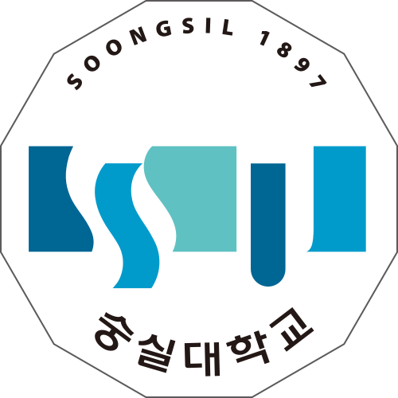 | **숭실평화통일 연구원 · SmartAI Lab** Undergraduate Researcher · Pyongsong social simulation | Apr – Aug 2026 |
|  | **Soongsil University** AI Software | Mar 2026 – Present |
|  | **KRAFTON Jungle** SW-AI Lab, 11th cohort · PintOS and EUM | Sep 2025 – Jan 2026 |
| 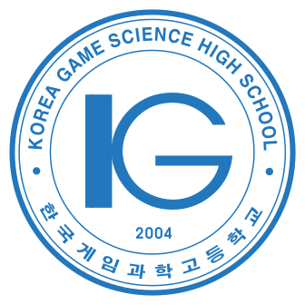 | **Korea Game Science High School** Computer Game Development · Student Council President · Founder and president of game development club Dash | Mar 2023 – Feb 2026 |
